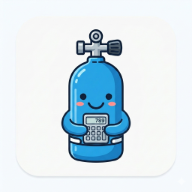
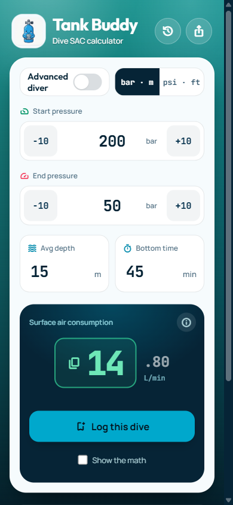

<p align="center">
  
</p>

<h1 align="center">Tank Buddy</h1>

<p align="center">
  A fast, offline-friendly SAC calculator for scuba divers.<br>
  <a href="https://tankbuddy.net"><strong>tankbuddy.net</strong></a>
</p>

<p align="center">
  
</p>

---

Punch in your start and end pressure, average depth and bottom time, and Tank Buddy gives you your **Surface Air Consumption (SAC)** rate: how much gas you breathe per minute at the surface. Because it's normalised to one atmosphere, you can compare dives at any depth and plan gas for the next one.

It's built for the dive boat: big tap targets, one-handed steppers, works offline once loaded, and installs to your home screen as an app.

## Features

- **Instant SAC.** Updates as you type, no submit button.
- **Metric and imperial.** Switch between bar · m and psi · ft. Your entered values convert, and the choice is remembered.
- **Advanced diver mode.** Twinsets and sidemount (up to 4 tanks), common tank presets (AL80, HP100/117/133, 10–15 L) or custom volume and working pressure. The layout compacts so everything fits on one phone screen.
- **One-tap copy.** Tap the green box to copy your SAC for your logbook: the whole number in metric, two decimals in imperial.
- **Dive history.** Log a dive and review past SAC rates with depth, time, pressures and tank. Stored only on your device.
- **Show the math.** Toggle the formula with your numbers plugged in.
- **Buddy up.** Share the app with a QR code or the native share sheet.
- **Why your SAC matters.** A short explainer on gas planning, reserves and lowering your SAC.
- **Installable PWA.** Add to home screen; a service worker caches the app shell for offline use.

## How it's calculated

**Metric (L/min)**

```
SAC = (start bar − end bar) × tank volume (L) × tanks
      ÷ (time (min) × (depth (m) / 10 + 1))
```

**Imperial (cu ft/min)**

```
tank factor = rated volume (cu ft) ÷ working pressure (psi)
SAC = (start psi − end psi) × tank factor × tanks
      ÷ (time (min) × (depth (ft) / 33 + 1))
```

Example: 200 → 50 bar on an 11.1 L tank, 45 min at 15 m average:
`(150 × 11.1) ÷ (45 × 2.5) = 14.80 L/min`.

## Tech

Everything ships as static files. There's no build step and no backend.

| | |
|---|---|
| UI | React 18 (UMD) with in-browser Babel, in a single `index.html` |
| Styling | Tailwind CSS 3 (Play CDN), Outfit / Manrope / JetBrains Mono, Material Symbols |
| Offline | `sw.js` service worker that caches the app shell |
| Storage | `localStorage`: `tankBuddyLogs` (dive history), `tankBuddyUnits` (unit choice) |
| Hosting | Cloudflare Pages, deployed automatically from `main` |
| Headers | `_headers` (no-cache for `sw.js` and the manifest), `_redirects` (keeps repo config files from being served) |

CDN scripts are pinned to exact versions with Subresource Integrity hashes where the CDN supports it.

## Run locally

Any static file server works:

```bash
git clone https://github.com/benk7557/Tank-Buddy.git
cd Tank-Buddy
npx http-server -p 8080 -c-1
# open http://localhost:8080
```

The service worker caches aggressively. While developing, use DevTools → Application → Service workers → "Update on reload", or unregister it. When you ship a change, bump `CACHE_NAME` in `sw.js` so installed copies update.

## Project structure

```
index.html      the whole app (markup, styles, React components)
sw.js           service worker (offline cache)
manifest.json   PWA manifest
_headers        Cloudflare Pages response headers
_redirects      Cloudflare Pages redirects
logo.png        mascot / app logo
icon-*.png      PWA icons
qr.svg          share QR code (links to tankbuddy.net)
docs/           README assets
```

## Privacy

There are no accounts and no tracking cookies. Your dive logs never leave your browser. The site uses Cloudflare Web Analytics, which is cookieless and collects aggregate page views only.

## Disclaimer

Tank Buddy is for informational purposes only. It is not a dive computer or a substitute for proper training and dive planning. Always verify calculations independently and finalise your dive plan with your buddy before entering the water.

---

<p align="center">Built by Ben Kaufman · Made with AI</p>
